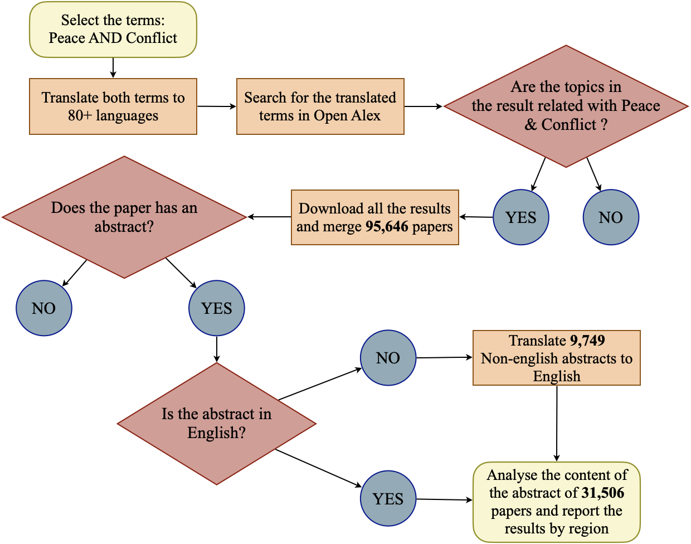

# When some peace never becomes (ack)knowledged: Towards the coloniality of non-knowledge in peace and conflict studies.

This library presentes a detailed methodology and empirical results of the paper [**When some peace never becomes (ack)knowledged: Towards the coloniality of non-knowledge in peace and conflict studies**](link), published in 31,506.

## 👥 Who is this for?
- **Researchers from the social sciences** that would like to perform bibliometrics or text analyses.
- **Social computer sciences** that would like to replicate this study in other domains than peace and conflict.
- **Policymakers and analysts** who would like to get involved in research policies to increase the participation of non-meanstream perspectives in the studies of peace and conflict.

## ✨ About

Through an analysis of 31,506 peace and conflict studies articles (1958-2024), this paper develops a novel framework for examining the epistemic conditions that prevent certain understandings of peace from becoming objects of knowledge. We argue that this stems not only from racialized, gendered, and Western-centric hierarchies, but from a coloniality of non-knowledge that selectively and structurally ignores particular actors, contexts, and histories. This shapes who is recognized as a legitimate knowledge producer and whose visions of peace matter. By foregrounding non-knowledge, we reveal how epistemic exclusions can constrain opportunities for peace for all.

## 🚀 Highlights
- 📈 Open Alex datasets about multilingual research on peace & conflict available for reproducibility 
- ⚖️ Full code to reproduce BERT based text labelling on concepts of peace and conflict.

## Table of Contents

1. [Methodology overview](#overview)
2. [Data labeling](#labeling)
3. [Human verification](#humans)
4. [Citation analyses](#citations)

## Methodology overview<a name="overview">

Flow chart with the steps to download the most worldwide diverse literature on Open Alex by different languages of publication and regions of the world for peace & conflict literature.

  

An exhaustive list of the files from which each step is taking place is as follows: 1) translated terms peace & conflict is in this table [link] for 86+ lenagues; 2) files derived from the manual search of the translated terms in Open Alex after manual verification of the top results and topic displayed by the platform is downloaded and stored in this folder [link]; 3) Filtering those papers with an abstract and detection of language of each abstract is in this file [link]; translation of the abstracts is carried in this file [file] and the corresponding translation files are in this folder [link]. In this file is the final merge of translated abstracts and this file [link] contains the entire final dataset for continuing the analyses.

## Data labeling name="labeling">

In this code you can find the labelling process where we: We first searched for the explicit appearance of each of the 30 dictionary terms in each translated abstract and in the ‘primary_topic’ defined by Open Alex. We then applied sentence transformers (Reimers and Gurevych, 2019), a natural language processing methodology that represents sentences as numerical vectors and measures their semantic proximity, to assess whether the conceptual content (its definition provided in the appendix Table A1) of a term was present in the abstract even when the exact word was not. In particular, we used the sentence-transformers model 'all-MiniLM-L6-v2' hosted in hugging-face, which has been previously trained with over a thousand million texts ranging from blogs to scientific academic content. We first removed stop words, numerical content, and then transformed the definitions into a numerical vector. Then, for each translated abstract in English we repeated the text cleaning process and this time we first divided the abstract in sentences strictly delimited by dot (using the sentence tokenization of NTKL), and transformed each sentence to a vector. Then, for the sentences of each abstract, we computed the cosine similarity between i) the numerical vector transformation of the concept definition provided in Table A1 vs ii) the numerical vector transformation of each sentence. The cosine similarity ranges from -1 when there is no similarity to 1 when the two vectors are identical. As an abstract might contain multiple sentences, we selected the sentence with the highest cosine similarity value for our further comparisons. This last decision obeys to the principle that abstracts of scientific papers highlight the main arguments of the entire article, and while other arguments might be explored and shown in the abstract, we filtered by that at least one of the sentences was related to the searched definition. Distributions of the cosine similarity

## Human verification <a name="humans">

## Citation analysis<a name="citations">

- **Maintainer:** Ana Maria Jaramillo (jaramillo@csh.ac.at)
- **License:** Apache 2.0
- **Contributors:** Ana Maria Jaramillo
